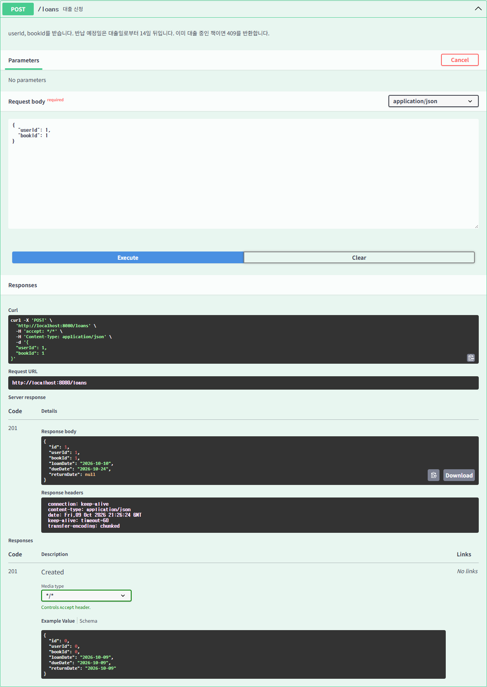
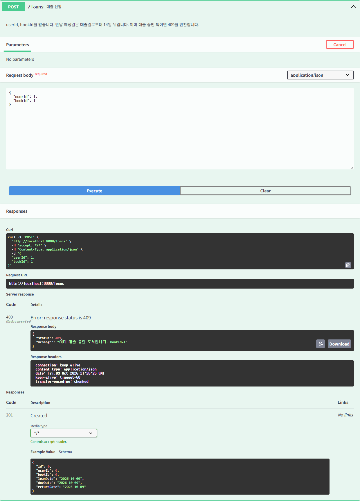
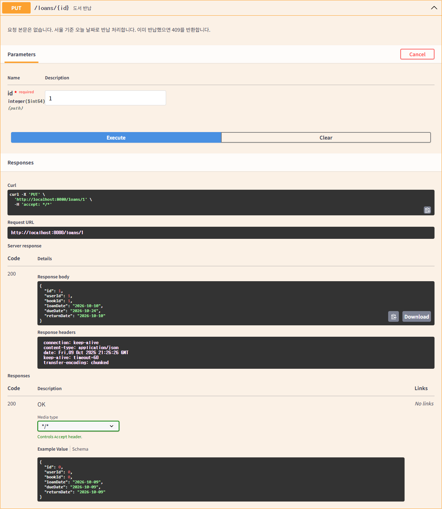
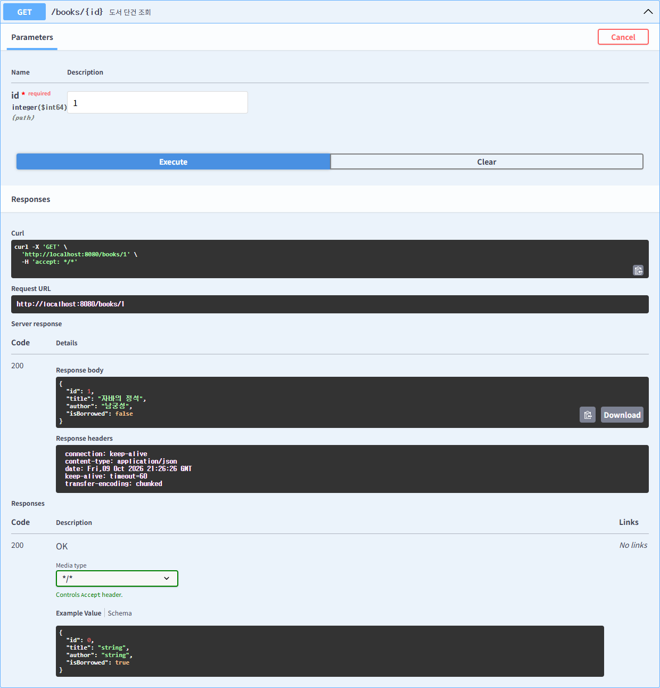
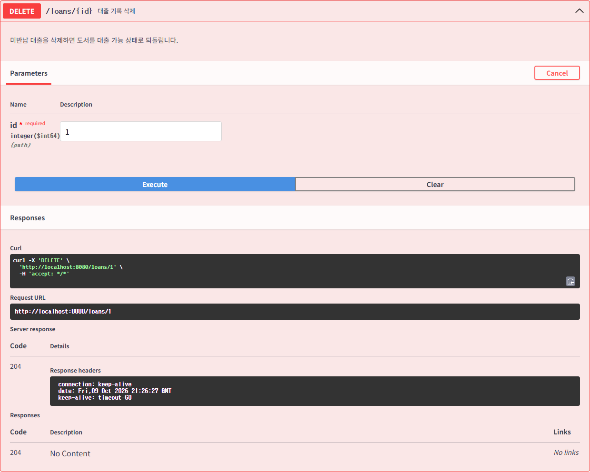

# Week 05 — 인증/인가 & JWT

Java 17 / Gradle / Spring Security / BCrypt / JWT 구현입니다. 작업 브랜치는 `week-05/sua`이며, `week-04/sua`에서 분기했습니다.

## IntelliJ 실행

1. `build.gradle`을 Gradle 프로젝트로 열고 Project SDK와 Gradle JVM을 **Java 17**로 설정합니다.
2. Gradle을 새로고침합니다.
3. Run → Edit Configurations → `LibraryApplication` → Environment variables에 `JWT_SECRET`을 설정합니다. 충분히 무작위인 **32바이트 이상의 UTF-8 문자열**이 필요하며 코드에 기본값은 없습니다.
4. ADMIN 테스트에 H2 콘솔을 쓰려면 Active profiles를 `dev`로 지정합니다. 기본 프로필에서는 콘솔에 접근할 수 없습니다.
5. 실행 후 [Swagger](http://localhost:8080/swagger-ui.html)를 엽니다. **Authorize**에는 토큰만 입력합니다.

PowerShell에서 이번 실행에 사용할 임시 비밀키를 생성해 실행할 수도 있습니다. 재시작마다 새 키를 생성하면 이전 토큰은 무효가 됩니다.

```powershell
$env:JAVA_HOME = 'D:\Java\temurin-17\jdk-17.0.20.1+1'
$jwtBytes = New-Object byte[] 32
$jwtRandom = [System.Security.Cryptography.RandomNumberGenerator]::Create()
$jwtRandom.GetBytes($jwtBytes)
$jwtRandom.Dispose()
$env:JWT_SECRET = [Convert]::ToBase64String($jwtBytes)
.\gradlew.bat bootRun --args='--spring.profiles.active=dev'
```

H2 메모리 DB이므로 서버를 종료하면 데이터가 초기화됩니다. 현재 프로젝트는 MySQL이 아니므로 Workbench의 `USE library` 예제 대신 아래 H2 콘솔을 사용하세요.

## API와 인증 흐름

- `POST /users/signup`: 이메일·비밀번호로 가입, 항상 USER, BCrypt cost 10으로 저장, 성공 `201`, 중복 `409 DUPLICATE_EMAIL`.
- `POST /users/login`: 성공 `200`, 토큰은 **`data.accessToken`**. 틀린 이메일·비밀번호는 `401 LOGIN_FAILED`.
- 회원가입 비밀번호는 BCrypt 제한에 맞춰 UTF-8 기준 72바이트까지 허용합니다.
- 이후 요청 헤더는 `Authorization: Bearer <토큰>`입니다. 토큰 유효기간은 기본 1시간이며 `JWT_EXPIRATION_SECONDS`로 설정할 수 있습니다.
- JWT 서명·만료·회원 식별값·역할을 검증해 `SecurityContext`에 인증 정보를 등록합니다. 세션은 사용하지 않습니다.
- 회원가입·로그인·Swagger 문서는 공개, 도서 등록/삭제는 ADMIN, 나머지는 로그인한 회원이 접근합니다.
- 기존 `POST /users`는 학습 코드를 유지하기 위한 인증 필요 경로입니다. 신규 가입은 공개 경로 `/users/signup`을 사용하세요.
- `GET /users/me`: 로그인한 회원 정보. 비밀번호는 응답하지 않습니다.
- `POST /loans`: **`{"bookId": 1}`**만 보냅니다. 회원 ID는 토큰에서 가져오며 임의의 `userId`를 보내도 대출 신청자를 바꿀 수 없습니다.
- `PUT /loans/{id}`: 본인 대출만 반납할 수 있으며 다른 회원이면 `403 FORBIDDEN`입니다.
- 기존 회원별 대출 조회 `GET /loans?userId=1`과 나머지 조회·삭제 API는 이전 계약을 유지합니다.

인증·인가 오류도 기존 `ApiResponse` 형식으로 반환합니다.

```json
{"success":false,"code":"UNAUTHORIZED","message":"로그인이 필요합니다.","data":null}
```

| 상황 | 상태 / code |
| --- | --- |
| 보호된 API에 토큰 없음 | 401 / UNAUTHORIZED |
| 변조·만료·형식 오류 토큰 | 401 / INVALID_TOKEN |
| USER의 ADMIN API 접근, 다른 회원의 반납 | 403 / FORBIDDEN |

## Postman 테스트와 ADMIN 준비

[Postman 컬렉션](docs/postman/week-05-library.postman_collection.json)을 Import합니다. 토큰과 생성된 도서·대출 ID는 응답에서 자동 저장하며, 실제 토큰이나 비밀키는 파일에 포함하지 않았습니다.

1. 새 서버에서 **1번 폴더**를 순서대로 실행합니다. USER A·B와 ADMIN 테스트용 계정이 생성됩니다. 이 시점에는 모두 USER입니다.
2. dev 프로필에서 [H2 콘솔](http://localhost:8080/h2-console)에 접속합니다. Driver `org.h2.Driver`, JDBC URL `jdbc:h2:mem:library`, User Name `sa`, Password는 빈칸입니다.
3. 콘솔에서 다음 SQL을 실행합니다. H2는 테이블 이름을 큰따옴표로 감쌉니다.

```sql
UPDATE "user" SET role = 'ADMIN' WHERE email = 'admin@test.com';
```

4. **2번 폴더**를 실행합니다. ADMIN으로 다시 로그인한 새 토큰을 받은 뒤 도서 생성·대출·타인 반납 거절·내 정보·본인 반납을 확인합니다.
5. 컬렉션 05·06·07 요청의 **401 / 200 / 403 응답을 각각 캡처**합니다. URL, 상태 코드, 응답 body가 보이게 하고 Authorization 헤더, Token 입력값, JWT_SECRET은 가리세요.

DB에서 역할을 바꿔도 기존 토큰의 역할은 유지됩니다. 반드시 다시 로그인해야 ADMIN 토큰을 받습니다. 컬렉션 재실행 시 중복 가입이나 중복 대출이 생길 수 있으므로 처음부터 확인하려면 서버를 재시작하세요.

실행 후 컬렉션을 다시 Export할 때는 `userToken`, `otherToken`, `adminToken`, `invalidToken` 값을 비우세요. 캡처는 Postman에서 직접 수행해야 하며, 저장소의 기존 `docs/screenshots`는 3주차 자료입니다.

## 검증 및 제출

```powershell
.\gradlew.bat test bootJar
```

테스트 비밀키는 테스트 실행 중 무작위 생성하므로 테스트에 환경변수 설정은 필요하지 않습니다. 기존 대출·예외 처리 회귀 테스트와 실제 JWT 기반 가입·로그인·권한·변조·만료·대출 소유권·Swagger 접근 테스트를 실행합니다.

- 제출 브랜치: `week-05/sua`
- PR 제목: `[5주차] 수아 - 인증/인가 & JWT`
- PR 본문: 구현 설명 및 Postman 캡처 3장 이상(401, 403, 200 각 1장)
- 커밋·원격 push·PR 생성은 별도로 진행합니다.

JWT 라이브러리 사용 참고: [JJWT 공식 문서](https://github.com/jwtk/jjwt/tree/0.12.6).

---

아래는 이전 주차 학습 기록입니다. 현재 인증 방식과 실행·테스트 절차는 위 5주차 설명을 기준으로 확인하세요.

# Week 04 — 예외 처리 & 응답 규격

Java 17 / Gradle 프로젝트입니다. IntelliJ에서 `build.gradle`을 열고 Project SDK와 Gradle JVM을 Java 17로 설정한 뒤 Gradle을 새로고침하고 `LibraryApplication`을 실행하세요.

## 이번 변경

- 회원·도서·대출 Controller의 성공/실패 응답은 `success / code / message / data` 네 필드로 통일합니다.
- 생성은 `201`, 조회·반납·삭제는 `200`입니다. 삭제도 응답 본문을 보내므로 `204`를 사용하지 않습니다.
- 성공 데이터와 생성된 ID는 `data`, `data.id`에서 확인합니다. 실패와 삭제 성공의 `data`는 `null`입니다.
- `BusinessException`과 `ErrorCode`로 없는 도서·회원·대출은 `404`, 중복 대출·반납 및 데이터 충돌은 `409`, 잘못된 입력은 `400`으로 처리합니다.
- `GET /loans?userId=1`은 회원별 대출 내역입니다. 회원이 없으면 `404 / USER_NOT_FOUND`, `userId`가 없으면 `400 / INVALID_REQUEST`, 회원의 내역이 없으면 빈 목록을 반환합니다.
- Validation과 `@Valid`를 적용하며, JSON 오류·파라미터 누락·타입 오류도 공통 응답으로 처리합니다.
- 없는 경로는 `404 / NOT_FOUND`, 지원하지 않는 메서드는 `405 / METHOD_NOT_ALLOWED`입니다.
- 예상하지 못한 예외는 서버에 기록하고 응답에는 내부 정보를 노출하지 않습니다.

성공 예시:

```json
{"success":true,"code":"SUCCESS","message":"요청에 성공했습니다.","data":[]}
```

실패 예시:

```json
{"success":false,"code":"BOOK_NOT_FOUND","message":"도서를 찾을 수 없습니다.","data":null}
```

## 실행 및 자동 테스트

```powershell
$env:JAVA_HOME = 'D:\Java\temurin-17\jdk-17.0.20.1+1'
.\gradlew.bat test bootJar
.\gradlew.bat bootRun
```

[Swagger UI](http://localhost:8080/swagger-ui/index.html)에서 수동 호출할 수 있습니다. 이번 작업 범위는 코드 적용과 자동 테스트이며, 4주차 Swagger 직접 호출과 제출용 캡처는 별도로 진행해야 합니다.

아래 내용은 **3주차 구현·실행·캡처 기록**입니다. 과거 응답 구조, `204` 삭제 응답, 전체 대출 조회 방식과 `scripts/swagger-smoke.cjs`는 4주차 계약을 반영하지 않은 자료입니다. 현재 동작은 위 설명을 기준으로 확인하세요.

---

# Week 03 — 도서관 대출 API

Java 17 · Spring Boot 3.3.13 · Spring Data JPA · H2 · Gradle 8.14.5

제공된 지난주 ERD에 맞춰 아래 모델로 구현했습니다. DB 컬럼은 `snake_case`, JSON 필드는 `camelCase`입니다.

ERD 파일: [library-erd.dbml](docs/library-erd.dbml)

- `User`: id, email(100자, 필수·고유), password(255자, 필수), createdAt
- `Book`: id, title(255자, 필수), author(255자, 필수), isBorrowed(필수, 기본값 false)
- `Loan`: id, user, book, loanDate(필수), dueDate(필수), returnDate(미반납이면 null) — 회원과 도서를 각각 다대일 관계로 연결

`user`는 H2 예약어이므로 테이블 이름을 인용해 ERD의 이름을 유지했습니다. 가입 일시는 서버에서 서울 시간으로 저장하며, 비밀번호는 [Spring Security의 PasswordEncoder](https://docs.spring.io/spring-security/reference/features/authentication/password-storage.html)를 사용해 PBKDF2 해시로 저장합니다. 회원 응답에는 `id`, `email`, `createdAt`만 포함합니다.

## IntelliJ IDEA 실행

1. 이 폴더의 `build.gradle`을 Open → **Open as Project**로 엽니다.
2. Project SDK와 Settings → Build Tools → Gradle → Gradle JVM을 **Java 17**로 설정합니다. 이 PC의 설치 경로는 `D:\Java\temurin-17\jdk-17.0.20.1+1`입니다.
3. Gradle 동기화 후 `LibraryApplication.main()`을 실행합니다.
4. [Swagger UI](http://localhost:8080/swagger-ui/index.html)를 엽니다.

PowerShell에서는 Java 17을 `JAVA_HOME`에 설정하고 실행합니다.

```powershell
$env:JAVA_HOME = 'D:\Java\temurin-17\jdk-17.0.20.1+1'
.\gradlew.bat bootRun
```

H2 메모리 DB를 사용하므로 서버를 종료하면 데이터가 초기화됩니다. 별도 DB 설치는 필요 없습니다.

## API

| 대상 | 목록 조회 | 단건 조회 | 생성 | 삭제 | 반납 |
| --- | --- | --- | --- | --- | --- |
| 회원 | GET /users | GET /users/{id} | POST /users | DELETE /users/{id} | — |
| 도서 | GET /books | GET /books/{id} | POST /books | DELETE /books/{id} | — |
| 대출 | GET /loans | GET /loans/{id} | POST /loans | DELETE /loans/{id} | PUT /loans/{id} |

생성은 `201`, 조회/반납은 `200`, 삭제는 본문 없이 `204`를 반환합니다. 잘못된 입력은 `400`, 없는 ID는 `404`, 중복 이메일/대출/반납 또는 대출 기록이 있는 회원·도서 삭제는 `409`입니다.

## Swagger에서 따라 하기

각 API를 펼쳐 **Try it out → Execute**를 누릅니다. 생성 응답의 실제 ID를 다음 요청에 사용하세요.

1. `POST /users`: `{"email":"sua@example.com","password":"practice-password"}`
2. `POST /books`: `{"title":"자바의 정석","author":"남궁성"}`
3. `POST /loans`: `{"userId":1,"bookId":1}` → `201`, `dueDate`는 `loanDate`로부터 **14일 뒤**, `returnDate: null`
4. `GET /books/1` → `isBorrowed: true`
5. 같은 `POST /loans`를 다시 실행 → `409` (중복 대출 거절)
6. `GET /loans`, `GET /loans/1` → 대출 DTO 조회
7. `PUT /loans/1` → **요청 본문 없이** 반납; 서울 기준 오늘 날짜로 `returnDate` 저장
8. `GET /books/1` → `isBorrowed: false`
9. `DELETE /loans/1` → `204`; 이후 `GET /loans/1` → `404`

반납을 다시 요청하면 `409`입니다. 대출 삭제는 과제용 취소 기능도 겸합니다. 미반납 대출을 삭제하면 책을 대출 가능 상태로 복구하고, 반납된 옛 기록을 삭제할 때는 현재 대출 상태를 유지합니다. 회원/도서는 연결된 대출 기록을 먼저 삭제해야 삭제할 수 있습니다.

## 코드 흐름

`LoanCreateRequest → LoanController → LoanService → LoanRepository → LoanResponse`

- Request DTO는 클라이언트가 전달한 `userId`, `bookId`를 검증합니다.
- Service가 회원·도서를 조회하고 `Book.isBorrowed`를 검사합니다.
- 대출 생성과 `book.borrow()`는 하나의 쓰기 트랜잭션에서 실행합니다. 조회한 Book의 변경은 JPA 변경 감지로 반영됩니다.
- 대출 Entity 생성 시 `loanDate.plusDays(14)`로 `dueDate`를 계산합니다. 대출일·반납 예정일은 서버가 결정하며, 반납해도 예정일을 유지합니다.
- 같은 책의 생성·반납·삭제는 `PESSIMISTIC_WRITE` 락으로 직렬화하여 동시 대출도 막습니다.
- 반납은 클라이언트 입력이 필요한 필드가 없어 Request DTO 없이 경로 ID만 받습니다.
- Response DTO는 연결된 Entity 대신 ID와 날짜를 반환합니다. Controller는 Service만 호출합니다.

## 검증

```powershell
.\gradlew.bat test bootJar
```

`LibraryApiTest`는 실제 H2 DB로 전체 대출 흐름, DTO 응답, 상태 변경, 입력 검증, 없는 ID, 중복 반납, 관련 데이터 삭제 제한, 옛 대출 삭제, 동시 대출 경쟁 및 Swagger 명세를 검증합니다. ERD에 따른 이메일 UNIQUE 제약, 비밀번호 해시 저장/응답 제외, 가입 일시, 255자 도서 필드, DB 기본값과 `due_date` 필수 제약도 검증합니다. 테스트 날짜를 고정해 서울 기준 날짜와 월을 넘기는 14일 계산을 확인합니다.

2026-10-10 검증 결과: Java 17 `test bootJar` 성공, 테스트 **15개 통과**, Swagger UI에서 실제 API **22회 호출 검증**, 스크린샷 **12장 저장**. 상세 응답은 [results.json](docs/screenshots/results.json)에서 확인할 수 있습니다.

Swagger UI 자동 검증/스크린샷을 다시 생성하려면 서버 실행 후 Node.js와 Chrome이 설치된 환경에서 다음을 실행합니다. 실제 Swagger의 Try it out/Execute 버튼으로 테스트 데이터를 만들고 검증 후 해당 데이터를 삭제합니다.

```powershell
npm install --prefix .tools --no-audit --no-fund playwright
node scripts/swagger-smoke.cjs
```

## 제출

제출 브랜치는 `week-03/sua`입니다.

스크린샷과 호출 결과는 `docs/screenshots`에 저장합니다. 원격 push는 수행하지 않았습니다.

### 제출 스크린샷

대출 생성 — `201 Created`



중복 대출 거절 — `409 Conflict`



반납 처리 — `200 OK`, `returnDate` 저장



반납 후 도서 상태 — `isBorrowed: false`



대출 기록 삭제 — `204 No Content`



회원/도서 생성, 대출 목록/단건 조회, 삭제 후 404, 중복 이메일 409 화면도 같은 폴더에 첨부했습니다.

### 체크리스트

- [x] Controller 응답은 Entity 대신 Response DTO
- [x] Controller는 Repository 대신 Service 호출
- [x] URI는 복수형 명사 `/users`, `/books`, `/loans`
- [x] 생성 API는 `201 Created`
- [x] 대출 생성 시 `Book.isBorrowed`도 `true`로 갱신
- [x] 반납 시 `returnDate` 저장 및 `Book.isBorrowed`를 `false`로 갱신
- [x] `@Tag` / `@Operation` 설명 및 Swagger 실제 호출 스크린샷
- [x] 중복 대출 방지 및 동시 요청 검증
- [x] ERD 필드·길이·필수 조건·이메일 고유 제약 반영
- [x] 반납 예정일은 대출일로부터 14일 뒤
- [x] 비밀번호 해시 저장 및 응답 제외

Swagger `2.6.0`은 과제 예시를 유지했으며, [springdoc 공식 호환표](https://springdoc.org/v2/#what-is-the-compatibility-matrix-of-springdoc-openapi-with-spring-boot)에 맞춰 Spring Boot 3.3.x를 사용했습니다.
